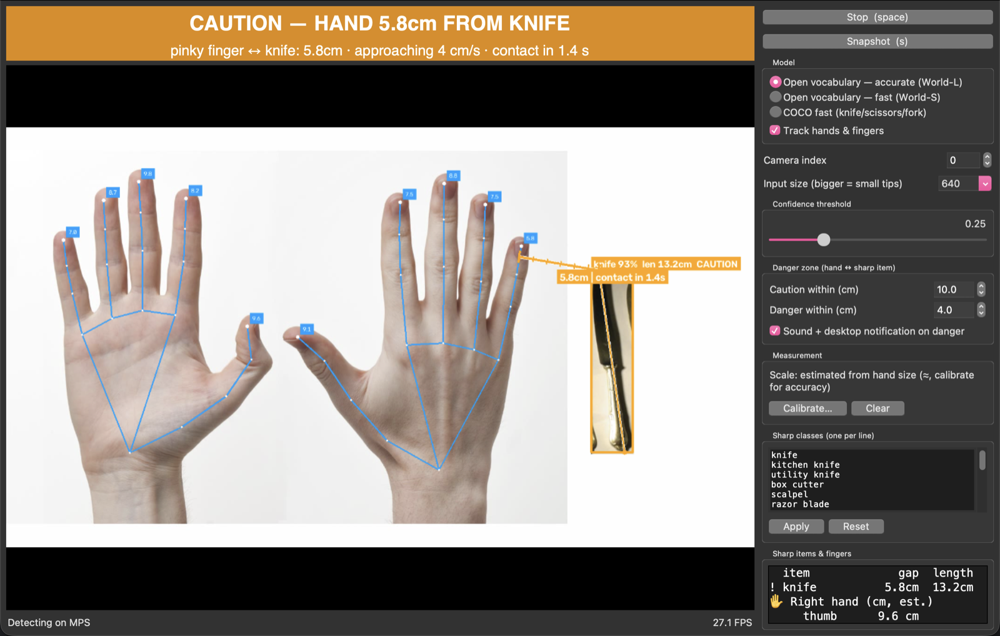

# Sharp Object Identifier

Live detection of sharp items from your desktop camera, with a Tkinter UI. It finds blades, points and needles with YOLO and tracks your hands and fingers with MediaPipe. It then measures **how far your hand is from each sharp item and how soon it will touch it**, and warns you before contact. It also measures the length of every item and finger.



*Test video: a knife moving toward a photo of real hands (YOLO-World L, scale estimated from hand size). The ruler line runs from the closest point on the hand (the pinky tip) to the closest point on the knife, with a tick every centimetre. The banner shows the gap (5.8 cm), the approach speed and the time to contact (1.4 s). The speed is low because the test video played slower than real time.*

## Quick start

Requires [uv](https://docs.astral.sh/uv/), which installs Python 3.12 and all dependencies automatically.

```bash
cd sharp_obj
uv run app.py
```

Press **Start** (or `space`) to turn on the camera. Model weights download on first use: about 90 MB for YOLO-World L, 8 MB for the hand model.

On macOS, the first start asks for Camera permission for your terminal. If you denied it, enable it under **System Settings › Privacy & Security › Camera** and restart the terminal.

To test without a camera, pass a video or an image:

```bash
uv run app.py --source clip.mp4 --autostart
uv run app.py --source photo.jpg --autostart
```

## What it does

**Detects sharp items.** By default it looks for 43 kinds of item that can cut or puncture a hand: knives, box cutters, scalpels, razor blades and scissors; pens, pen nibs, pencils, compasses, thumbtacks and push pins; needles, syringes, safety pins, nails, screwdrivers and skewers; broken glass, metal shards and can lids. You can edit the list in the app.

**Ignores harmless look-alikes.** Spoons, chopsticks, markers, phones and similar items are also given to the model as options, then dropped from the results. That gives the model a better name for a spoon than "knife".

**Tracks hands and fingers.** MediaPipe finds 21 points on each hand and draws a skeleton over it.

**Measures the gap between your hand and each sharp item.** A ruler line is drawn from the closest point on the hand (fingertip, finger or palm) to the closest point on the item. It is labelled with the gap in cm and, when you're moving toward the item, the time to contact.

**Warns you before contact:**

| Banner | When |
|---|---|
| 🟩 SAFE | No sharp item, or the gap is more than the caution distance |
| 🟧 CAUTION | Gap ≤ 10 cm, or contact expected within 2 s |
| 🟥 DANGER | Gap ≤ 4 cm, or contact expected within 0.8 s |
| 🟪 CONTACT | Gap ≤ 1 cm, or touching |

Contact time counts too, so a hand moving quickly toward a blade turns DANGER while it's still far away. The second line of the banner shows which part of the hand is closest, the gap, and the approach speed. The caution and danger distances are adjustable in the **Danger zone** panel.

When the level rises to DANGER or CONTACT, the app plays a sound and shows a desktop notification (macOS: Notification Center; Linux: `notify-send`). It repeats every 3 s while you stay in danger and keep moving closer, and stays quiet while you move away. Turn this off with the checkbox.

**Measures lengths.**
- **Sharp items** are measured along their long axis (the line drawn on each item), not the box diagonal.
- **Fingers** are measured from the knuckle to the tip; the thumb is measured from its base joint. Each length is labelled at the fingertip and listed in the side panel.

**Keeps the camera running.** From Start to Stop the feed stays live. Model switches and class edits load in the background, and the camera reconnects on its own if it drops.

## Measuring in centimetres

A camera only sees pixels, so the app picks a scale in this order:

1. **Calibrated.** Click **Calibrate…**, click both ends of something of known length (a ruler or a credit card, which is 8.56 cm) held where you'll be measuring, then type the real length. This is the most accurate option.
2. **Hand estimate.** With no calibration, the app uses MediaPipe's estimate of the visible hand's real size. It's roughly right for an average adult hand, and is shown as "est." in the panel.
3. **Pixels.** With no calibration and no hand in view, lengths are shown in px.

Scales are only accurate for objects at the **same distance from the camera** as the reference. Fingers pointing toward the camera look shorter than they are.

## Models

| Option | Weights | Detects | Speed (M-series Mac) |
|---|---|---|---|
| **Open vocabulary — accurate** (default) | `yolov8l-worldv2.pt` | Anything in the class list | ~33 FPS model only |
| Open vocabulary — fast | `yolov8s-worldv2.pt` | Anything in the class list | ~80 FPS model only |
| COCO fast | `yolo11n.pt` | knife, scissors, fork only | fastest |

The whole app, including hand tracking and drawing, runs at about 10–25 FPS.

## Controls

| Control | Action |
|---|---|
| `space` | Start / stop |
| `s` | Save the annotated frame to `snapshots/` |
| Confidence slider | Applies live. Raise it to cut false alarms |
| Input size | 960 or 1280 helps with small tips (pen nibs, pins) but runs slower |
| Sharp classes → **Apply** | Use your edited list without stopping the camera |
| **Calibrate…** / `Esc` | Start / cancel calibration |
| Danger zone | Caution / danger distances in cm, plus the sound + notification switch |

## Limitations

- **Labels are often wrong even when detection is right.** In testing, a fountain pen and a thumbtack were both flagged as sharp but labelled "scissors", and a stylus was labelled "knife". Treat the label as a hint and the warning as the signal.
- **There are false alarms.** A porcelain soup spoon was flagged as "scissors". Raise the confidence threshold, or remove classes you don't need.
- **Small and thin points** (pen nibs, needles, razor blades) are hard to see at webcam resolution. Bring them closer or raise the input size.
- **Hand tracking is built for real hands** and can miss unusual ones; a marble statue's hand stopped being detected after video compression. Gloves, bad lighting and hands partly out of frame are likely to make it worse (not yet tested).
- **Gaps are measured in the image plane, not in 3D.** A hand hovering *above* a knife, nearer the camera, can show a gap of 0 cm without touching it. A single webcam can't see depth, so mount it looking down on the work surface and treat CONTACT as "about to touch". Items or fingers tilted toward the camera also measure short.
- **The cm scale is an estimate unless you calibrate.** Without calibration the scale comes from your hand's estimated size, so gaps can be off by roughly 10–20%. Calibrate for real measurements.
- **Detection can lag or miss frames.** If an item isn't detected for a few frames, no warning is shown for it. Don't rely on the app alone.
- **This is a demo, not a safety system.** Don't rely on it to protect anyone. For dependable results, train a YOLO model on labelled photos of your own objects.

## Files

```
app.py            Tk UI, camera worker, YOLO detection, drawing
hands.py          MediaPipe hand + finger tracking and finger lengths
measure.py        Item length along its axis, px → cm formatting
proximity.py      Hand ↔ item gap, approach speed, time to contact, danger levels
pyproject.toml    Dependencies (uv)
docs/screenshot.png
models/           Hand model, downloaded on first run
snapshots/        Created on first snapshot
```
